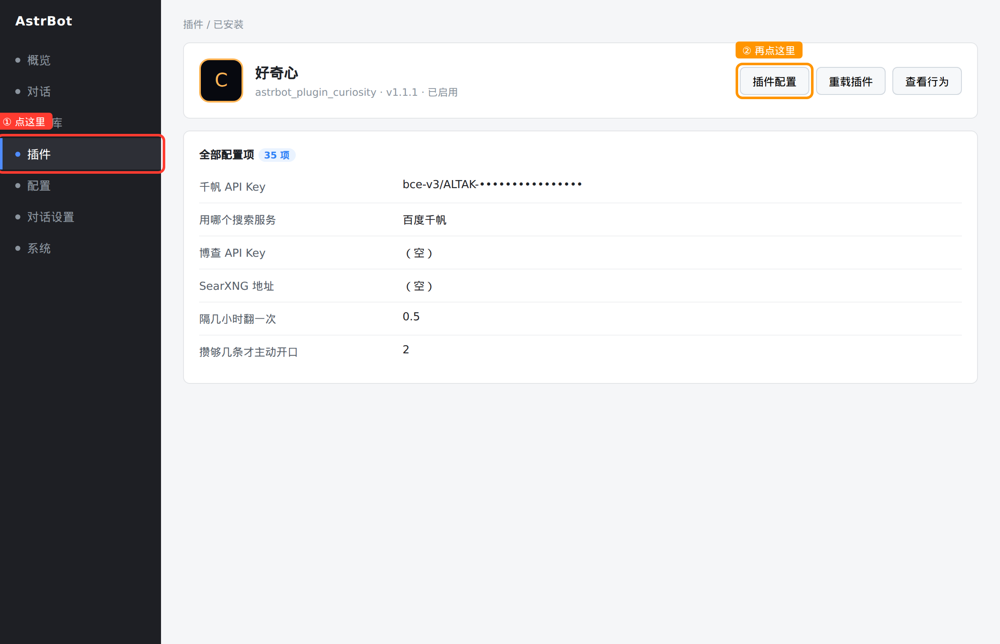

# 好奇心

让 bot 自己上网翻新东西，看见有意思的就攒着，回头讲给你听。

不是搜索框的包装。它按你的兴趣出去翻，把翻到的东西拆成一条一条存在本地，
攒到点了就用自己的语气念叨给你听 —— 不列条目、不写成资讯播报。

```
定时触发 ──► 挑方向（清单 / 自行探索）
                 │
                 ▼
            联网搜索（六种后端任选）
                 │
                 ▼
            模型拆条 ──► SQLite（按 URL + 硬专名去重）
                 │
        ┌────────┴────────┐
        ▼                 ▼
  用自己的语气讲       评分够高就发 QQ 空间
```

## 它做什么

| 能力 | 说明 |
| --- | --- |
| 联网搜索 | 千帆 / 博查 / SearXNG / 自定义 JSON 接口 / AstrBot 自带搜索，任选一种 |
| 拆条入库 | 模型把搜索结果拆成「标题 / 一句话 / 为什么有意思 / 评分」 |
| 去重 | URL 指纹 + 标题二元组相似度 + 硬专名共现，三层闸 |
| 主动讲述 | 攒够门限、不在免打扰时段就自己开口 |
| 看心情 | 打开后由它自己决定什么时候讲，攒够了才一定讲 |
| 自行探索 | 一部分轮次会换个角度自己找，不是死磕清单 |
| 发 QQ 空间 | 评分够高的条目写一条说说发出去，可带配图 |
| 自然语言 | 「有什么新鲜事」直接触发，不用记指令 |

---

# 教程

下面五节按顺序看一遍，就能从零跑起来。已经跑起来的话，直接跳到
[第 4 节 常见场景](#4-常见场景照着抄就行)。

## 1. 第一次用：从装好到能跑

### 第 1 步 · 装插件

把整个目录放进 `AstrBot/data/plugins/astrbot_plugin_curiosity/`，重启 AstrBot。

装对了的话，AstrBot 日志里会出现这一行：

```
Plugin astrbot_plugin_curiosity (1.1.1) by yangtuoor: 好奇心...
[astrbot_plugin_curiosity] 已加载；启用=True 节奏=3.0h 联网=astrbot 总结模型=（跟随默认） ...
```

> **没看到这行？** 说明插件没加载上。去面板 →「插件」看看列表里有没有「好奇心」。
> 没有就是目录放错了；有但是灰色的，把它的开关打开。

### 第 2 步 · 想清楚用哪家搜索

这是唯一一个「不填就跑不起来」的地方。先对着这张表选：

| 你的情况 | 选哪个 | 要不要花钱 |
| --- | --- | --- |
| 什么都没准备，想先跑起来试试 | **AstrBot 自带搜索** | 免费 |
| 想要稳定、能搜到当天新闻 | **百度千帆**（推荐） | 每天 100 次免费，够用 |
| 已经有博查的 key | 博查 | 试用送额度，之后按次收费 |
| 自己有台服务器、愿意搭 SearXNG | SearXNG | 完全免费，但要自己维护 |
| 已经有现成的搜索 API | 自定义 JSON 接口 | 看你接的什么 |
| 就是不想联网 | 直接问模型 | 免费但**会编**，不建议 |

**决策建议**：没想法就选**百度千帆**，去 [百度智能云千帆控制台](https://console.bce.baidu.com/qianfan/)
开一个应用，拿到 API Key（形如 `bce-v3/ALTAK-xxxxxxxx/xxxxxxxx`）。

### 第 3 步 · 把 key 填进去

这一步是新用户最容易卡住的地方，所以有截图。

**① 在左边菜单点「插件」**

**② 在插件列表里找到「好奇心」，点它卡片上的「插件配置」按钮**



**③ 进去以后是这 35 项。** 找到 `千帆 API Key` 那一栏，把 key 粘进去，保存。

> 这个页面叫「插件配置」，有时候也叫「配置」「编辑配置」，
> 取决于 AstrBot 的版本和主题 —— 位置始终在插件卡片的右上角。

### 第 4 步 · 确认真的生效了

改完不要凭感觉，按下面两条验证其中一条即可。

**方法 A（推荐，不用等）**：打开观察站面板 →「设置」页签，最上面那条参数栏会写
`联网 千帆`，说明读到了新配置。

**方法 B**：对 bot 说一句 `/翻翻 今天有什么科技新闻`，然后去「航行日志」看那一行。
成功的话「取回」那一列是大于 0 的数字。

> **取回一直是 0？** 先看「航行日志」里那一行有没有红色失败说明。
> - 红字写 `搜索超时` → 去设置页把「一次搜索最多等几秒」调大
> - 红字写 `千帆返回 HTTP 401` → key 填错了，回第 3 步重填
> - 没有红字、成功但取回 0 → 上游那天确实没新内容，换个方向再试

### 第 5 步 · 告诉它讲给谁听

默认状态下它**不会主动找你说话**，只有你开口问它才讲。想让它主动讲，要填「讲给谁听」。

在观察站面板 →「设置」→「讲述」里填，或者去「插件配置」页找 `讲给谁听（target_umo）`。

格式是 `平台ID:FriendMessage:QQ号`，例如：

```
snowluma:FriendMessage:1919667560
```

> **不知道自己的平台 ID 是什么？** 去面板 →「配置」→「平台」，看你配的那个平台
> 名字叫什么（通常就是 `aiocqhttp` 或你起的名字）。群聊把中间那段换成 `GroupMessage`，
> 后面换成群号。

填完之后，`攒够几条才主动开口` 默认是 2 —— 意思是攒到两条它才会来跟你说话。

---

## 2. 「插件配置」和「观察站设置」的关系

新手最容易困惑的就是这两个页面。一句话：

> **观察站设置** = 25 项日常旋钮，改错了会当场告诉你哪里不对
> **插件配置** = 全部 35 项，包括那些「填错整轮都跑不了」的

| | 观察站 →「设置」页签 | 插件 →「插件配置」 |
| --- | --- | --- |
| 能改多少项 | 25 项常用项 | 全部 35 项 |
| 打开方式 | 插件卡片 →「查看详情」→ 设置页签 | 插件卡片 →「插件配置」 |
| 保存后要不要重启 | **不用** | **不用**（AstrBot 会热重载） |
| 改错了会怎样 | 当场提示「这一项没通过，其余照常保存」 | 存进去就是存进去了，出错要等下一轮扫描才发现 |
| API Key / 接口地址 | **故意不放** | 在这里 |

**为什么 API Key 不放观察站？**

因为 key 填错的表现非常难认：整轮扫描全失败，报错只有一句 `HTTP 401`，
和「网络不通」「额度用完」长得一模一样。放在需要多走两步才能改的地方，
至少让人改之前先想一想。

> 面板保存只写白名单里的 25 个键，其余 10 个键原样不动 ——
> 所以在观察站点了保存，**不会把你的 API Key 冲掉**。

---

## 3. 五种搜索源怎么配

每种都在「插件配置」页里配。下面是「填哪个字段、长什么样、怎么验证」。

### 百度千帆（推荐）

| 字段 | 填什么 |
| --- | --- |
| `千帆 API Key`（字段全名 `qianfan_api_key`） | `bce-v3/ALTAK-xxxxxxxx/xxxxxxxx` |
| `用哪个搜索服务` | 选 `百度千帆` |

免费额度 **每天 100 次**，按天重置。验证方式：`/翻翻 测试`，日志里出现
`搜索引擎=qianfan（千帆 key 已配，top_k=6，时间=oneWeek）` 就是对的。

### 博查 Bocha

| 字段 | 填什么 |
| --- | --- |
| `博查 API Key`（字段全名 `bocha_api_key`） | 博查控制台给的 key |
| `用哪个搜索服务` | 选 `博查 Bocha` |

### 自建 SearXNG

| 字段 | 填什么 |
| --- | --- |
| `SearXNG 地址`（字段全名 `searxng_base_url`） | 你的实例地址，如 `http://127.0.0.1:8888` |
| `用哪个搜索服务` | 选 `自建 SearXNG` |

**必须做的额外一步**：在 SearXNG 自己的 `settings.yml` 里找到 `search.formats`，
把 `json` 加进去：

```yaml
search:
  formats:
    - html
    - json     # ← 少了这一行，插件永远拿不到结果
```

### 自定义 JSON 接口

适合接自己搭的、或者别人给的搜索 API。要填六项：

| 字段 | 说明 | 例子 |
| --- | --- | --- |
| `自定义接口地址`（`custom_endpoint`） | 完整 URL | `https://api.example.com/search` |
| `请求方式` | `GET` 或 `POST` | `POST` |
| `自定义接口 API Key` | 没有就留空 | `sk-xxx` |
| `自定义请求头` | JSON 字符串 | `{"X-Key":"{key}"}` |
| `自定义请求体` | 只有 POST 用 | `{"q":"{query}","n":{top_k}}` |
| `自定义结果字段路径` | 结果数组在响应里的位置 | `data.items` |

请求体里可以写三个花括号占位标记，发出去之前会被自动替换：
`{query}` 换成搜索词，`{key}` 换成 API Key，`{top_k}` 换成条数。

字段路径支持数组下标，比如 `data.results.0.list`。

### AstrBot 自带搜索

`用哪个搜索服务` 选 `AstrBot 自带搜索`，不用填任何 key。

这是**零配置回退方案**，但不同 AstrBot 版本对外暴露的搜索接口不一样，
可能用不了。它失败时会自动往下试千帆 / 博查 / SearXNG（你配了哪个就用哪个）。

### 不联网

选 `直接问模型`，它不去网上搜，只凭模型自己的记忆答。**会编造不存在的消息**，
而且照样花 token。只在调试时用。

---

## 4. 常见场景（照着抄就行）

### 「平时别烦我，我问了再说」

| 设置项 | 改成 |
| --- | --- |
| 攒够了就自动讲 | **不勾** |
| 总开关 | 勾上 |

这样它还会照常翻、照常存，但一次都不会主动开口。你问它「有什么新鲜事」才讲。

### 「每天上班路上给我讲一条」

| 设置项 | 改成 |
| --- | --- |
| 讲给谁听 | 你的私聊标识 |
| 攒够了就自动讲 | 勾上 |
| 攒够几条才主动开口 | `1` |
| 隔几小时翻一次 | `1` |
| 免打扰时段 | `23` 到 `7`（夜里不打扰） |

### 「攒一批一起讲，别碎碎念」

| 设置项 | 改成 |
| --- | --- |
| 攒够几条才主动开口 | `5` |
| 讲话字数上限 | `400` |

### 「让它自己拿主意，什么时候讲看心情」

| 设置项 | 改成 |
| --- | --- |
| 看心情讲 | 勾上 |
| 有心情讲的比例 | `0.6`（六成会讲） |
| 憋到几条就非讲不可 | `5`（攒满 5 条不管心情直接讲） |

### 「只想让它盯着一个方向」

| 设置项 | 改成 |
| --- | --- |
| 想让它关注的方向 | 只留一行，比如 `具身智能和机器人最近有什么进展` |
| 自己跑偏的概率 | `0`（永远只按这一行搜） |

### 「不想花钱」

- `用哪个搜索服务` 选 **百度千帆**（每天 100 次免费）
- 「隔几小时翻一次」填 `3` 或更大
- 「一次最多把多少字的资料交给模型」调到 `1500`
- 「一次捞几条结果」调到 `4`

按这个配，一个月成本约等于 0（AstrBot 本身用的模型除外）。

---

## 5. 出问题怎么自己查

**先看这三个地方，90% 的问题能定位：**

1. **观察站 →「航行日志」** —— 每一轮的成败、取回几条、耗时、用的哪个引擎
2. **观察站 →「设置」→ 参数栏** —— 确认配置真的读进去了（`联网 千帆`）
3. **观察站 →「设置」→「口吻」→ 当前实际用的人格** —— 框里是空的，说明没读到人格

### 症状对照表

| 症状 | 最可能的原因 | 怎么办 |
| --- | --- | --- |
| 航行日志一直是「取回 0，新增 0」 | 上游那天真没新内容 | 换个方向；或者看时间范围是不是设太窄 |
| 红字 `搜索超时（120s）` | 网络慢或上游挂了 | 设置页把「一次搜索最多等几秒」调到 180 |
| 红字 `千帆返回 HTTP 401` | key 错或过期 | 回「插件配置」重填 key |
| 红字 `千帆返回 HTTP 429` | 当天 100 次免费用完 | 等第二天，或换博查 |
| 日志显示 `搜索引擎=none` | 联网方式没选 | 设置页选一家，保存 |
| 它说话了但内容很干 | 资料喂太少 / 条数太多 | 「一次最多把多少字的资料交给模型」调大到 4000 |
| 它说话的口气不像我配的角色 | 人格没读到 | 看「当前实际用的人格」框，空的话去 AstrBot 人格页检查 |
| 设了自动讲但从不主动说话 | 没填「讲给谁听」 | 填上你的私聊标识 |
| 保存设置提示「没有改动」 | 值本来就一样 | 不是错误，忽略 |
| 保存设置提示「没通过」 | 某一项不合法 | 按提示改那一项，其余照常保存了 |

### 手动排查用的指令

| 指令 | 作用 |
| --- | --- |
| `/翻翻状态` | 一眼看到节奏、联网方式、讲给谁、门禁配置 |
| `/翻翻 测试` | 强制跑一轮，立刻看日志 |
| `/攒了什么` | 库里还有几条没讲 |

---

## 指令

| 指令 | 作用 |
| --- | --- |
| `/翻翻 [方向]` | 立刻翻一轮，不给方向就按兴趣挑 |
| `/攒了什么` | 看看手里有多少还没讲的 |
| `/讲讲` | 马上讲给你听（忽略门限和免打扰） |
| `/发空间` | 把最有趣的一条发到 QQ 空间 |
| `/翻翻状态` | 最近翻得怎么样 |
| `/清空攒的` | 把没讲的都扔了 |

`/` 可以省略，`/翻翻` 和 `翻翻` 都认。唤醒前缀不是 `/` 也没关系，插件自己剥。

## 自然语言

@它说这些就行，模型会自己调对应工具：

- 「有什么新鲜事」「你最近翻到啥」→ 讲一条
- 「你攒了多少」→ 报库存
- 「去找点新东西」→ 立刻翻一轮
- 「发个说说」→ 发 QQ 空间

## 面板

打开 AstrBot 面板 → 插件 → 好奇心 →「查看详情 / 打开」，
点进去就是观察站。一共四个页签。

### 指挥舱

进去第一眼看到的是它现在什么状态。

| 区域 | 看什么 |
| --- | --- |
| 参数栏 | 状态（在跑/停了）、节奏、联网方式、用哪个模型、讲给谁、门限、心情模式、QQ 空间 |
| 四块大读数 | 待讲 / 库存总计 / 已讲过 / 扫描轮次 |
| 让讲门限 | 一根充能条，满了就自动开口；下面写着上一轮翻的方向 |
| 任务简报 | 它现在照什么在翻（方向清单 + 口吻 + 参数），只读 |
| 手动操盘 | 三个按钮，见下 |

**手动操盘三个按钮**（平时不用点，定时器自己跑）：

- **立刻扫一轮** —— 输入框留空就随机挑方向，填了「太空探索」就只翻这个。
  跑完会在按钮下面显示「取回 N 条，新增 M 条」。
- **提炼并发送** —— 忽略门限和免打扰，现在就把库里的东西讲一次。
- **发个说说** —— 挑评分最高、还没发过的那条发到 QQ 空间。

### 藏品库

它攒下来的每一条都在这里，按时间倒序。

- 顶部搜索框能按标题 / 摘要 / 方向筛
- 每条卡片显示：标题、站点、时间、方向、评分（右侧琥珀色数字）、
  一句话摘要、为什么值得讲、原文链接、是否已讲
- 点「再看一些」继续往下翻

### 航行日志

每一轮扫描的记录：时间、方向、成功/失败、取回几条、新增几条、耗时、用的哪个引擎。
失败的行会多一行红字说明原因（比如「搜索超时（120s）」）。

排查「为什么它没翻到东西」先看这里 —— 如果是持续取回 0 条但成功，
多半是上游那天真没新内容，不是插件的问题。

### 设置

**常用设置都在这个页签里改，不用去「插件配置」页，也不用重启。**

页签顶部有一条工具栏，左边写着「改完按右边『保存改动』，立刻生效，不用重启」，
右边是「撤回改动」和「保存改动」。

页面最上面有一张「这一页在哪儿」的卡片，写了怎么找到「插件配置」页 —— 
需要改 API Key 时按那四步走。

下面分六块。

#### 1. 搜索源

单独放最前面，因为它是根本 —— 没配好其他都白搭。

| 显示的名字 | 配置键 | 说明 |
| --- | --- | --- |
| 用哪个搜索服务 | `search_engine` | 下拉选六种之一 |
| 一次搜索最多等几秒 | `search_timeout_seconds` | 网络慢就调大，默认 60 |
| 用哪个模型来写（可留空） | `search_provider_id` | 留空 = 用 AstrBot 当前默认模型 |

选定后端后，**下面只会显示这一种源要填的参数**：

- 选**百度千帆** → 出现「一次捞几条结果」`qianfan_top_k`、「只要多长时间以内的」`qianfan_recency`
- 选**博查 Bocha** → 出现「一次捞几条结果」`bocha_count`
- 选**自建 SearXNG** → 出现「只要多长时间以内的」`searxng_time_range`
- 选**AstrBot 自带 / 自定义 / 不联网** → 只有一段说明

每个块底下都会写清楚「还差什么才能用」以及**具体去哪里填**
（左边菜单「插件」→「好奇心」→「插件配置」→ 找对应字段）。

#### 2. 翻什么

| 显示的名字 | 配置键 | 说明 |
| --- | --- | --- |
| 想让它关注的方向 | `topics` | 一行写一条，全部删空会恢复内置默认五条 |
| 隔几小时翻一次 | `interval_hours` | 可以填小数，0.25 = 每 15 分钟 |
| 自己跑偏的概率（0 到 1） | `explore_ratio` | 0 = 只按清单搜，1 = 永远自己换角度，0.35 = 约三成自行发挥 |
| 一次最多收几条 | `max_items_per_run` | 这一轮最多存几条进库 |

#### 3. 讲述

| 显示的名字 | 配置键 | 说明 |
| --- | --- | --- |
| 讲给谁听（填会话标识） | `target_umo` | `平台ID:FriendMessage:QQ号` 或 `平台ID:GroupMessage:群号`，留空就只等你开口 |
| 攒够几条才主动开口 | `deliver_threshold` | 填 1 = 攒到一条就讲 |
| 讲话字数上限 | `compose_max_chars` | 默认 220 |
| 总开关 | `enabled` | 关掉后不再自己出门翻，手动指令还能用 |
| 攒够了就自动讲 | `auto_deliver` | 不勾就必须你开口它才讲 |
| 看心情讲 | `mood_mode` | 它自己判断够不够有意思 |
| 憋到几条就非讲不可 | `mood_threshold` | 只在勾了「看心情讲」时生效 |
| 有心情讲的比例（0 到 1） | `mood_skip_chance` | 0.7 = 七成会讲，三成继续憋 |
| 免打扰时段 | `quiet_hours` | 填两个 0-24 的整点，默认 1 到 8（夜里不打扰） |

#### 4. 口吻

| 显示的名字 | 配置键 | 说明 |
| --- | --- | --- |
| 口吻补充（一般留空） | `persona_hint` | 留空 = 完全用 AstrBot 里配的人格；填了会在人格之外再补一句，比如「讲东西喜欢打比方」 |

下面有个只读框，**显示当前实际在用的人格全文** —— 打开这个页签就会去
AstrBot 的人格管理器里实时取一次，取不到会写「（AstrBot 里没读到人格，将只用默认口吻）」。

排查「它说话不像我配的那个角色」先看这个框：如果框里是空的，
说明人格没被读到，问题在 AstrBot 的人格配置（比如会话上强制绑了别的人格，或者全局默认是 default）。

#### 5. 省 token

| 显示的名字 | 配置键 | 说明 |
| --- | --- | --- |
| 一次最多把多少字的资料交给模型 | `raw_char_limit` | 默认 3000。调小省钱，调大留细节 |

#### 6. QQ 空间

| 显示的名字 | 配置键 | 说明 |
| --- | --- | --- |
| 自动把攒到的好东西发到 QQ 空间 | `qzone_enabled` | 开关 |
| 说说自动带图 | `qzone_with_image` | 拿原文链接当配图 |
| 多少分以上才发（1 到 10） | `qzone_min_score` | 默认 8，只发它觉得特别有意思的 |

> **设置里的值和「插件配置」里的不一致怎么办？**
> 不会不一致 —— 两边读写的是同一个配置文件。
> 观察站设置只是个「白名单编辑器」，只写上面这 25 个键，其余 10 个键碰都不碰。

**只在「插件配置」页里能改的 10 项**（观察站故意不放）：

| 字段 | 配置键 | 为什么不在观察站 |
| --- | --- | --- |
| 千帆 API Key | `qianfan_api_key` | 填错整轮全失败，报错只有 `HTTP 401`，认不出是填错了 |
| 博查 API Key | `bocha_api_key` | 同上 |
| SearXNG 地址 | `searxng_base_url` | 填错一个斜杠就静默失败 |
| 自定义接口地址 | `custom_endpoint` | 同上 |
| 自定义请求方式 | `custom_method` | 改错整个请求发不出去 |
| 自定义接口 API Key | `custom_api_key` | 同 API Key |
| 自定义请求头 | `custom_headers` | 要写 JSON，写错了插件读配置时会报错 |
| 自定义请求体 | `custom_body` | 同上 |
| 自定义结果字段路径 | `custom_items_path` | 路径写错就永远取不到结果 |
| 自定义字段映射 | `custom_map` | 同上 |

## QQ 空间联动

打开 `qzone_enabled` 后：

- 每轮翻完，评分 ≥ `qzone_min_score` 的新条目会自动发一条说说
- 说说文案由模型按你的人格写，不抄标题、不贴链接
- `qzone_with_image` 打开时把原文链接当配图地址传过去

**需要你先装一个提供发布工具的 QQ 空间插件**（插件会自动在已注册的 LLM 工具里
按名字找发布工具）。找不到会说一声，不影响主流程。

## 数据

全在 `data/plugin_data/astrbot_plugin_curiosity/curiosity.db`：

| 表 | 内容 |
| --- | --- |
| `finds` | 攒下的每一条（标题 / 摘要 / 为什么 / 链接 / 评分 / 是否讲过 / 是否发过空间） |
| `runs` | 每轮扫描的记录（方向 / 成功与否 / 取回几条 / 新增几条 / 耗时 / 用了哪个引擎） |
| `prefs` | 上次扫描时间等杂项 |

升级插件时会自动补新列，不会丢数据。

## 常见问题

**为什么讲了但内容很干？**
`raw_char_limit` 太小或者 `max_items_per_run` 太大都会稀释质量。适当降低条数、
提高 `qzone_min_score` 之类的门槛。

**AstrBot 自带搜索不可用怎么办？**
不同版本暴露的接口不一样。日志里会写明试过哪些接口。
最稳的是换成 `qianfan`（每天 100 次免费）或自建 SearXNG。

**它会不会一直讲重复的东西？**
不会。讲过的永久标记 `delivered`，翻到重复的入库前就被三层去重挡掉了。

**在设置页改了，要重启吗？**
不用。保存后会立刻写进配置文件，插件的配置属性每次读都从配置对象取，
下一次扫描就用新值。只有「用哪个搜索服务」改成另一家后端时，
如果那家的 key 还没填，会在下一轮报错 —— 先去「插件配置」页把 key 补上。

**「插件配置」按钮找不到？**
看本文第 1 节的第 3 步，那里有截图。位置在插件卡片右上角，
不同版本可能叫「插件配置」「配置」「编辑配置」。

**设置页保存后提示「没有改动」？**
说明表单里每个值与磁盘上的相同，没东西可写。这不是错误。

**设置页有个别项提示「没通过」？**
那一项的值不合法（比如联网方式填了不认识的后端名，或者数值超了区间），
这一项不会写进去，其余项照常保存。提示里会写明是哪几项、为什么。

## License

[AGPL-3.0](LICENSE)

本项目采用 GNU Affero General Public License v3.0 授权。
